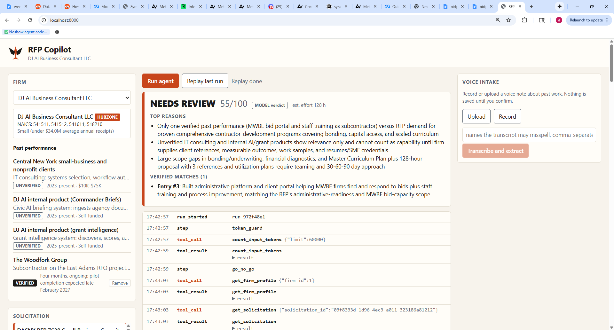

# RFP Copilot

FastAPI service that ingests government solicitations (pasted text, PDF, or SAM.gov notice id), tags the sections that matter for a bid/no-bid decision, and pulls a firm's daily opportunity shortlist from CivicProcureBot. LLM work runs on Meta's Muse Spark through the Meta Model API.

## What pre-existed

- **CivicProcureBot shortlist API** — a separate, already-running service (<https://github.com/Durl15/civicprocurebot>). Its shortlist endpoint is **read-only**; RFP Copilot only proxies it (`GET /shortlist/today`) and never writes to it. Nothing in this repo modifies CivicProcureBot.

## What was built during the hackathon

Everything in this repository, built Oct 26 – Nov 4, 2026:

| Piece | Location |
|---|---|
| Config from env, SQLite schema + versioned migrations | `app/config.py`, `app/db.py` |
| Meta Model API client: retry (3x, exponential backoff on 429/5xx), per-call logging to `llm_calls`, streaming | `app/llm/meta_client.py` |
| Solicitation ingestion (text / PDF / SAM notice), section + field tagger, `solicitations` table | `app/ingest.py`, `app/routes.py` |
| CivicProcureBot shortlist proxy | `app/shortlist.py` |
| Test suite | `tests/` |

### Meta capabilities used

| Capability | Where | Status |
|---|---|---|
| Responses API via the OpenAI SDK (`base_url` = Meta endpoint) | `MetaClient.complete` | Used |
| Structured output (`text.format` JSON schema) | Tagger gap-fill, `json_schema=` | Used |
| `reasoning.effort` (minimal / low / medium / high) | Every call; tagger uses `low` | Used |
| Files API | PDF upload on ingest; `file_id` stored on the solicitation | Used |
| Streaming | `MetaClient.stream` | Implemented, not yet called by a route |
| Tool use | `tools=` passthrough on `complete` / `stream` | Implemented, not yet called by a route |

Reasoning and structured output use native Responses API parameters (`reasoning`, `text.format`, `previous_response_id`; see the top of `app/llm/meta_client.py`). The Files API `purpose` is still plain HTTP using the assumed wire format in `app/ingest.py`; confirm it against the Meta Model API reference.

## Setup

```powershell
python -m venv .venv
.\.venv\Scripts\python.exe -m pip install -r requirements.txt
copy .env.example .env   # then fill in the keys
.\.venv\Scripts\python.exe -m uvicorn app.main:app --port 8003
```

Port 8003 avoids the usual 8000–8002 collisions on the dev machine. Migrations run automatically at startup.

## Configuration

| Variable | Default | Purpose |
|---|---|---|
| `MODEL_API_KEY` | – | Meta Model API key |
| `META_API_BASE` | `https://api.meta.ai/v1` | Meta endpoint |
| `META_MODEL` | `muse-spark-1.3` | Model id |
| `CIVICPROCUREBOT_API_BASE` | – | CivicProcureBot base URL |
| `CIVICPROCUREBOT_API_KEY` | – | Sent as `X-API-Key` (assumed header; see `app/shortlist.py`) |
| `SAM_API_KEY` | – | Only for `sam_notice_id` ingestion |
| `DB_PATH` | `data/rfp_copilot.sqlite3` | SQLite file (local dev) |
| `COPILOT_ADMIN_KEY` | – | Required `X-Admin-Key` for `POST /agent/run-daily`, `POST /solicitations/{id}/demo-label` and the past-performance remove route; also bypasses per-IP abuse limits. Blank means those endpoints reject everything |
| `GCS_BUCKET` | – | GCS bucket for database persistence. Unset = no storage sync (local dev, tests) |
| `MAX_DAILY_RUNS` | `150` | Global cap on agent runs per rolling 24 hours (429 beyond it) |
| `LOG_LEVEL` | `INFO` | Python log level |
| `MAX_RUN_INPUT_TOKENS` | `60000` | Token guard: a run whose first-call input exceeds this stops with `step_failed` |
| `PRICE_IN_PER_MTOK` / `PRICE_OUT_PER_MTOK` | `0.50` / `2.00` | USD per million tokens for `est_cost_usd`. Assumed rates: set Meta's actual pricing |

Do not wrap values in quotes in Railway or `.env`.

## API

- `POST /solicitations` — one of:
  - JSON `{"text": "..."}`
  - multipart with a PDF in field `file`
  - JSON `{"sam_notice_id": "..."}`

  Returns the tagged record (`due_date`, `naics`, `set_aside`, `participation_goals`, `place_of_performance`, `section_c/l/m`, `file_id`, and `llm_filled`, the list of fields the model had to fill because regex missed them).
- `GET /solicitations/{id}`
- `GET /shortlist/today?firm_id=` — CivicProcureBot proxy
- `POST /agent/run` `{firm_id, solicitation_id, override_no_bid: false}` — Server-Sent Events: go/no-go, then matrix, narrative, capability statement. A `no_bid` verdict stops after go/no-go (reasons in `decision` and `run_complete`) unless `override_no_bid` is true. A `needs_review` verdict runs the compliance matrix only (no narrative or capability statement) and `run_complete.export_url` points at `kind=matrix`; `bid` runs the full chain. The stream sends an SSE `: keepalive` comment every 15 seconds of silence. Events: `run_started`, `step_started`, `tool_call`, `tool_result`, `decision`, `matrix_row`, `narrative`, `capability_statement`, `step_failed`, `run_complete`; each carries `seq` and `timestamp`. The token guard counts input tokens first and stops with `step_failed` above `MAX_RUN_INPUT_TOKENS`.
- `GET /runs/{run_id}` — the stored event log of a run, for replay with no model spend. Every `llm_calls` row carries its `run_id`; estimated cost is logged per run.
- `POST /agent/run-daily` `{firm_id}` with header `X-Admin-Key` (`X-API-Key` is still accepted) — pulls the CivicProcureBot shortlist, ingests the top 3 by score, runs the chain on each, and returns a summary list. If the shortlist is unreachable or errors, it falls back to every `demo=true` solicitation plus any ingested in the last 14 days, records a `shortlist_fallback` event (reason included, stored with `solicitation_id` `daily`), and returns the reason under `fallback`. It never fails because the shortlist is down and never sends email.
- `GET /demo/solicitations`
- `POST /solicitations/{id}/demo-label` `{demo, title?, due_date?, set_aside?, participation_goals?}` with header `X-Admin-Key` (= `COPILOT_ADMIN_KEY`) — sets `demo` and the given fields; an omitted field is untouched, a field sent as `null` is cleared.
- `GET /health`

Tagging is regex first (Sections C/L/M, due date, NAICS, set-aside, place of performance); a single structured-output Muse Spark call fills only the gaps and never overwrites a regex hit. If that call fails, the regex result is stored as-is.

- `set_aside` is a category the contract is restricted to (HUBZone, 8(a), SDVOSB, WOSB, small business). Utilization goals such as "MBE 18%, WBE 12%, SDVOB 6%" are not a set-aside; they go in `participation_goals`.
- `due_date` is the proposal/response due date. Questions deadlines, pre-proposal conferences and issue dates never qualify; when only those are present the regex pass leaves it empty and the model fills it.
- State and local solicitations have no federal Section C/L/M labels. The model maps their scope, submission instructions and evaluation criteria onto C, L and M, and `llm_filled` records which fields it filled.

## Go/no-go past-performance floor

The model returns `verified_matches` (`{entry_index, why}`) for the past-performance entries it relied on; `entry_index` is shown in `get_firm_profile` and `search_past_performance`. Code keeps only entries whose index exists, is unique, and has `verified=true`; the rest go to `rejected_matches` with a reason. The floor counts the kept list: 0 forces `no_bid` (score cap 35), 1-2 cap at `needs_review` (score cap 65), 3+ leave the verdict alone, and hard blockers force `no_bid`. Both lists are stored on the decision and returned in `decision`.

## Voice intake

`POST /voice/past-performance` (multipart: `audio`, `firm_id`, optional `hints`) accepts any audio upload (m4a, mp3, wav, ogg, webm, aac). It is converted with ffmpeg to 16 kHz mono 16-bit PCM WAV, transcribed, then extracted into a pending entry that only reaches the firm's past performance after `POST /voice/confirm`. `hints` is a comma-separated list of proper nouns (e.g. `The Woodfork Group, East Adams`); a transcribed name that is a close phonetic match is written with the hint spelling in the field value while the evidence quote stays verbatim. Unreadable audio returns 400 `unsupported or corrupt audio`; ASR failures return 502 after one retry on 5xx/timeout.

Muse Voice Transcribe contract (`POST {META_API_BASE}/asr/transcribe`, bearer `MODEL_API_KEY`):

- Multipart with exactly two parts: `request` (`application/json`: `{"model": "muse-voice-transcribe-1.0", "audioEncoding": "WAV"}`) and `audio` (`audio/wav`). Other part names return 400.
- WAV only, mono 16-bit PCM at 16 or 24 kHz. m4a, mp3 and other encodings are rejected.
- 200 response: `{"sessionId", "transcript", "audioDurationMs", "turns": []}`.

Conversion uses ffmpeg from the `imageio-ffmpeg` package (no system ffmpeg). The `imageio-ffmpeg` 0.7.0 `manylinux2014_x86_64` wheel bundles a linux x86_64 ffmpeg binary, so the Railway image needs no change.

Smoke test (one real call): `python scripts/voice_smoke.py <audio> [firm_id] [--hints "a, b"]`.

## Deploy (Google Cloud Run)

Project `dj-ai-grant-consultant`, region `us-east1`, service `rfp-copilot`. **The Cloud Run service URL is the live product link for the hackathon submission.** Run from the repo root in PowerShell, with `gcloud` authenticated and `MODEL_API_KEY` and `COPILOT_ADMIN_KEY` set in `.env`:

```powershell
.\scripts\seed_prod.ps1       # once, before the first deploy: uploads data
fp_copilot.sqlite3 to gs://rfp-copilot-data (refuses if it already exists; -Force overrides)
.\scripts\deploy.ps1          # idempotent: APIs, bucket, service account, secrets, Cloud Build + deploy, then GET /health and /solicitations
.\scripts\schedule_daily.ps1  # creates or updates Cloud Scheduler job rfp-copilot-daily: 07:30 America/New_York, POST /agent/run-daily
```

`seed_prod.ps1` makes production start with the DASNY 7628 solicitation and the confirmed Woodfork entry from your local database. Secret values are read from `.env` (deploy) or Secret Manager (schedule) and never printed.

| Variable | Cloud Run value | Source |
|---|---|---|
| `MODEL_API_KEY` | – | Secret Manager `MODEL_API_KEY` |
| `COPILOT_ADMIN_KEY` | – | Secret Manager `COPILOT_ADMIN_KEY` |
| `META_API_BASE` | `https://api.meta.ai/v1` | env var |
| `META_MODEL` | `muse-spark-1.3` | env var |
| `DB_PATH` | `/tmp/rfp_copilot.sqlite3` | env var |
| `GCS_BUCKET` | `rfp-copilot-data` | env var |
| `LOG_LEVEL` | `INFO` | env var |
| `MAX_DAILY_RUNS` | `150` | env var |

`CIVICPROCUREBOT_API_BASE`, `CIVICPROCUREBOT_API_KEY` and `SAM_API_KEY` are not set by `deploy.ps1`; until they are, the daily run uses its shortlist fallback.

### Persistence model

SQLite runs on the container's ephemeral disk at `DB_PATH` and is mirrored to `gs://$GCS_BUCKET/rfp_copilot.sqlite3` as a whole file (`app/storage.py`):

- On startup, if the bucket has the file it is downloaded **before** migrations and seeding. A storage error at that point aborts startup, so an empty database can never overwrite the real one.
- After any committed write (ingest, decision, confirm, reject, remove, run events), an upload is scheduled 5 seconds out; writes in that window share the one upload. The upload is a consistent snapshot (sqlite backup API, WAL-safe). Shutdown uploads once more. Each sync is logged at INFO with its byte size.
- Seeding only inserts missing firms and the demo solicitation; restarts never duplicate rows.
- **Single-instance constraint:** whole-file sync has no merge, so two instances would overwrite each other. The service is deployed with `--min-instances 1 --max-instances 1` (one writer, no cold start during the demo) and `--no-cpu-throttling` so the debounced upload and in-flight runs get CPU outside a request. Writes in the last 5 seconds before a crash can be lost.

### Abuse limits

The URL is public, so (in memory, per process, which is correct only with one instance):

- Per IP: 6 agent runs per hour across `POST /agent/run`, `/agent/go-no-go` and `/agent/matrix`, and 10 uploads per hour on `POST /voice/past-performance`. Requests with a valid `X-Admin-Key` bypass the per-IP limits. The IP is the last `X-Forwarded-For` entry (the address Cloud Run appends).
- Global: `MAX_DAILY_RUNS` (default 150) agent runs per rolling 24 hours, admin included. `POST /agent/run-daily` is not counted.
- Both return `429` with a plain message. Voice uploads over 25 MB return `413`.

## Console

Open the agent console at `GET /` (a static page, no build step: `app/static/index.html`, `console.js`, `console.css`). Left: firm, past performance (VERIFIED/UNVERIFIED), solicitation picker. Center: **Run agent** streams `POST /agent/run` as a live trace, then the verdict card, Matrix / Narrative / Capability tabs and .docx downloads. **Replay last run** plays the stored events at 8x. Right: voice intake (upload or record, confirm or reject).



`GET /solicitations` lists demo and ingested solicitations newest first. `DELETE /firms/{firm_id}/past-performance/{entry_index}` (header `X-Admin-Key` = `COPILOT_ADMIN_KEY`) removes an entry and records a `past_performance_removed` event; the console's Remove button asks for the key once per browser session.

Demo reset sequence between takes:

1. Remove the Woodfork entry (Remove button on its VERIFIED row).
2. Run the agent: `no_bid` by rule (zero verified matches).
3. Record the voice note, review the fields, **Confirm**: the entry appears as VERIFIED.
4. Run the agent again: `needs_review`.

## Demo data

**Demo firms and demo solicitations are fictional.** Firms 2 and 3 (`demo=true`) and the seeded county facilities electrical maintenance solicitation (NAICS 238210, HUBZone set-aside, Syracuse) are invented for demonstration; none of their clients, contracts, values or references are real. Firm 2 carries three `verified=true` past-performance entries that match the demo solicitation, so a run on it reaches a `bid` or `needs_review` verdict. Firm 1 is the only real firm.

The DASNY RFP 7628 (Small Business Capacity Building Services) demo solicitation is a real, closed NYS RFP with its due date shifted forward, and its title says so. It is labelled with `POST /solicitations/{id}/demo-label`, not by editing the database.

## Tests

```powershell
.\.venv\Scripts\python.exe -m pytest
```

Drop sample solicitations in `tests/fixtures/*.pdf` to enable the real-PDF tagger test; it skips when the folder is empty.

## Known limits

- SQLite with whole-file GCS sync, single instance only (see Deploy). Move to Postgres before real multi-user data lands.
- Token counting uses the Responses API `input_tokens` endpoint (`MetaClient.count_input_tokens`); it is not verified against Meta's live API. If it fails, the run stops at the token guard rather than spending unchecked.
- Scanned (image-only) PDFs are rejected: no OCR yet.
- Only Sections C, L, and M are captured.
